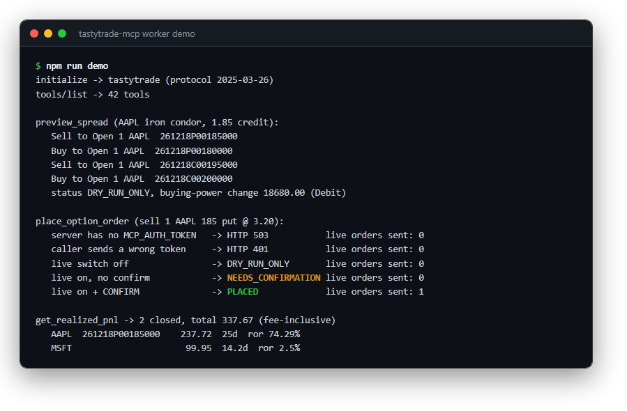
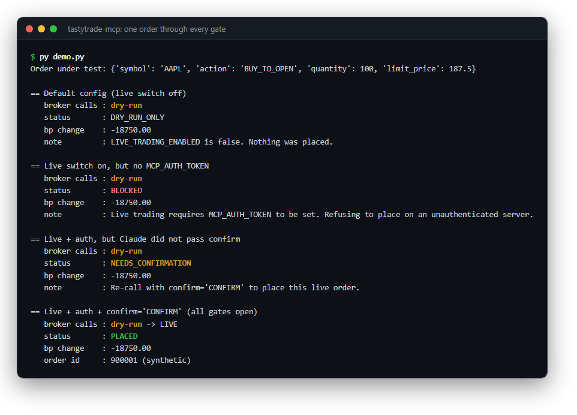
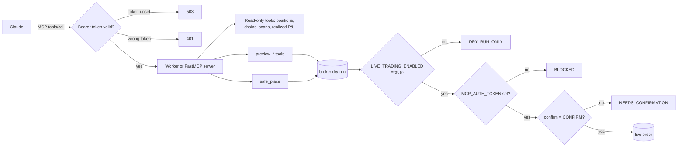
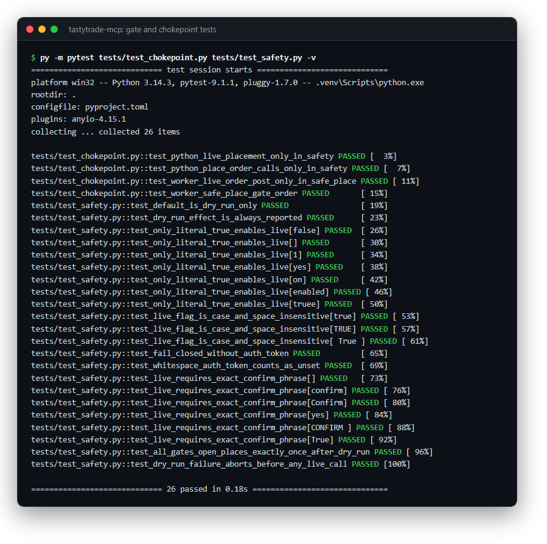
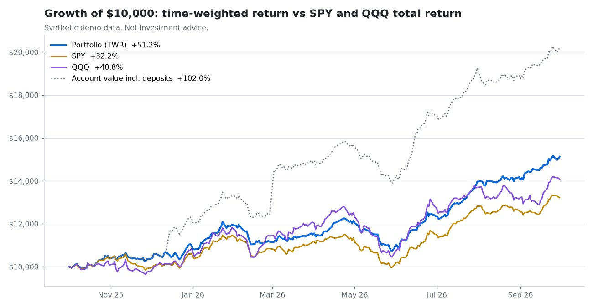
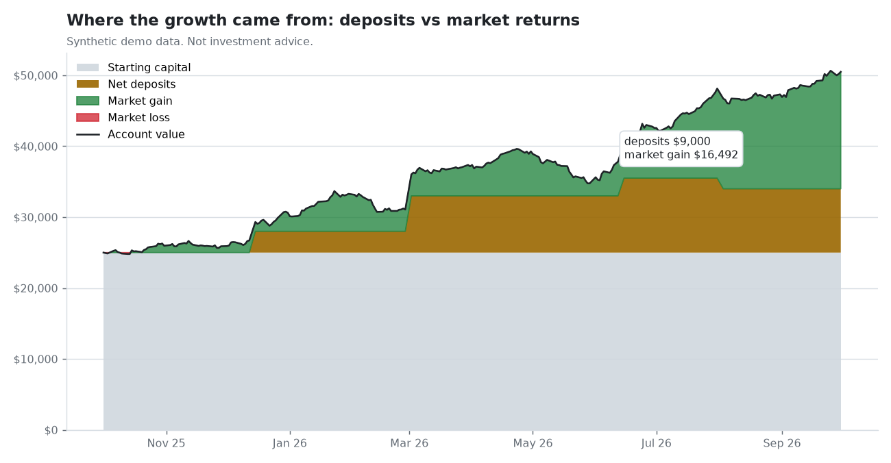
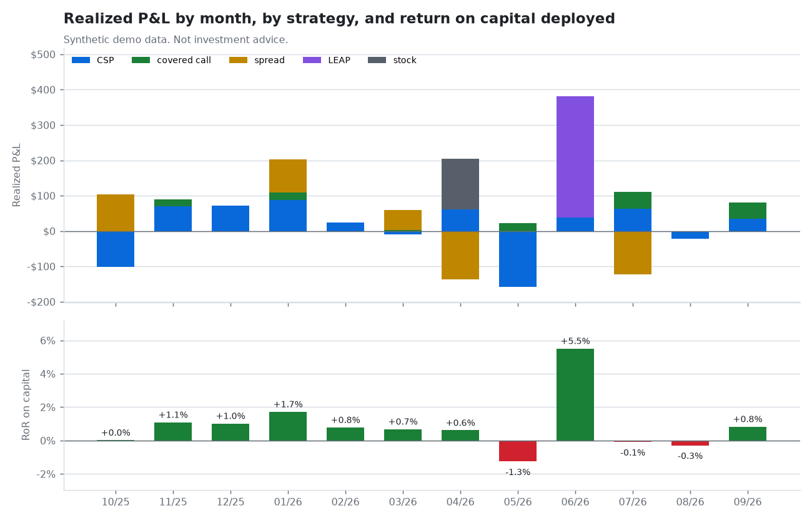

# tastytrade-mcp

**Claude can read the whole options book. It can only place an order after the operator switch is on and you confirm that specific order in the chat.**


*`npm run demo` drives the real Worker over MCP against a fake broker API. One order, five settings, exactly one live order sent.*

> **Not investment advice.** This is software for working with your own account. Nothing here tells you what to buy or sell.

I built this with my 11-year-old son as a weekend learning project. It's an MCP server that connects Claude to a Tastytrade brokerage account. Every order is dry-run first. Going live takes an operator switch (`LIVE_TRADING_ENABLED`) plus a per-order confirmation, and the human confirmation happens in the chat client. The endpoint itself refuses every caller until an auth token is configured.

> **A word from my co-developer.** Built by an 11-year-old, with parent supervision. He'd like everyone to know his custodial account beat QQQ and the S&P 500 this year, and he's right, it did. Gotta start 'em early. (And no, he's not available for hire. He has homework. I'm joking!) Not investment advice; past results don't predict anything.

## The problem

Handing an AI agent API access to a brokerage account is the same control problem as giving a new hire signing authority on the operating account. Read access is worth a lot: positions, P&L, option chains, screens. Write access needs segregation of duties, a preview of the financial effect before anything posts, and a clear record of who approved it.

## What it does

- **42 tools** in a single-file Cloudflare Worker (remote, so Claude works from any device), plus a 14-tool Python FastMCP server for local use.
- Account reads: balances, positions, working orders, portfolio greeks.
- **Realized P&L matching.** Pairs opening and closing fills per contract, fees included, with holding period and return on basis.
- Options analytics: chains with live greeks, a delta-targeted strike picker, the options-implied **expected move**, 25-delta skew, and dealer **gamma exposure** (GEX, gamma flip, call/put walls, max pain).
- Screeners: a **wheel / cash-secured-put** scan ranked by annualized return on risk, a lower-Bollinger-band CSP scan, and a **LEAPS finder**.
- **Multi-leg spreads** (verticals, iron condors, calendars) sent as one net-priced order.
- Research and macro context: analyst targets, seasonality, fundamentals, earnings history, CNN Fear & Greed, and the market-implied Fed path.
- **Performance tracking.** Realized return by month and by strategy, a time-weighted return that ignores deposits, and a comparison with SPY and QQQ total return. See below.

## Controls

| Control | How it works | Where it is tested |
|---|---|---|
| Dry-run first | Every order, live ones included, goes to the broker's dry-run endpoint first. The buying-power effect and warnings come back before anything else happens. A rejected dry-run stops the request. | `tests/test_safety.py`, `worker/test/worker.test.mjs` |
| Operator switch | `LIVE_TRADING_ENABLED` must be the literal `true`. The default is `false`, and `1`, `yes` or `on` don't count. | both suites |
| Endpoint auth fails closed | On the Worker, `/mcp` answers `503` to everyone while `MCP_AUTH_TOKEN` is unset or under 32 characters, and `401` to a missing or wrong bearer token. The compare is constant-time and there's no query-string token. `safe_place` also refuses live orders without the token, as a second line. | `worker/test/worker.test.mjs`, `tests/test_safety.py` |
| Per-order confirmation | Each live call must carry `confirm="CONFIRM"` (exact, case-sensitive), otherwise it returns `NEEDS_CONFIRMATION`. Claude shows you the dry-run in the chat and asks first. | both suites |
| Single chokepoint | All placement goes through one function (`safe_place` / `safePlace`). Source-level tests fail if a second live-order path shows up anywhere. | `tests/test_chokepoint.py` |
| Same order, checked and posted | The live order body is identical to the dry-run body. | `worker/test/worker.test.mjs` |
| Sign derivation | Callers pass a positive price and debit or credit comes from the action (BUY = debit, SELL = credit), so a negative price can't flip a debit into a credit. Spreads need an explicit `DEBIT` or `CREDIT`. | `tests/test_orders.py`, worker suite |
| Preview tools are inert | `preview_*` tools have no live path at all, even with every switch on. | both suites |
| No secrets in code | Credentials come only from environment variables or Worker secrets. Account numbers are never printed. | `.env.example`, repo scanner |

Not gated, on purpose: `cancel_order` (it reduces exposure) and watchlist edits (no money moves).


*`py demo.py`: the dry-run happens every time and reports the buying-power effect. The order only goes through with the switch on, the token set and `CONFIRM` passed.*

## Architecture



The bearer check applies to the Worker's HTTP endpoint. The local Python server talks over stdio, so it relies on the `MCP_AUTH_TOKEN` check inside `safe_place`.

Two runtimes share one tool contract:

- `worker/`: a dependency-free Cloudflare Worker that hand-rolls the MCP streamable-HTTP transport, the Tastytrade REST API and the DXLink WebSocket feed for live greeks and candles. This is the full 42-tool deployment.
- Repo root: a Python FastMCP server on the official `tastytrade` SDK, for local stdio use with Claude Desktop. The core order and scan tools plus two performance tools (14 in all), same order rules.

## Quickstart

Demo mode, no account needed. Requires Python 3.10+ and Node 20+.

```powershell
git clone https://github.com/markvalderrama001-svg/tastytrade-mcp.git
cd tastytrade-mcp
py -m venv .venv
.venv\Scripts\python -m pip install -r requirements.txt -r requirements-dev.txt
.venv\Scripts\python -m pytest
.venv\Scripts\python demo.py
.venv\Scripts\python -m performance --demo

cd worker
npm install
npm run build
npm test
npm run demo
```

<details>
<summary>macOS / Linux</summary>

```bash
git clone https://github.com/markvalderrama001-svg/tastytrade-mcp.git
cd tastytrade-mcp
python3 -m venv .venv
.venv/bin/python -m pip install -r requirements.txt -r requirements-dev.txt
.venv/bin/python -m pytest
.venv/bin/python demo.py
.venv/bin/python -m performance --demo
cd worker && npm install && npm run build && npm test && npm run demo
```

</details>

`demo.py` walks one AAPL order through every gate setting. `npm run demo` drives the real Worker over MCP JSON-RPC against a fake Tastytrade API: tool list, an iron-condor preview, the gate matrix and a realized-P&L report, all from synthetic fixtures. The gate part looks like this:

```text
place_option_order (sell 1 AAPL 185 put @ 3.20):
   server has no MCP_AUTH_TOKEN   -> HTTP 503           live orders sent: 0
   caller sends a wrong token     -> HTTP 401           live orders sent: 0
   live switch off                -> DRY_RUN_ONLY       live orders sent: 0
   live on, no confirm            -> NEEDS_CONFIRMATION live orders sent: 0
   live on + CONFIRM              -> PLACED             live orders sent: 1
```

The pytest suite stubs the `tastytrade` SDK and also runs the Worker's Node tests, so `pytest` alone covers both runtimes.


*The gate tests. Only the literal `true` turns live on, only the exact `CONFIRM` places, and source-level checks fail if a second live-order path appears.*

## The strategy it supports

My son and I mostly run the wheel, and the tool list follows that.

**The wheel.** Sell a cash-secured put on a stock you'd be fine owning. If it expires worthless, keep the premium and do it again. If you get assigned, you own 100 shares, so you sell covered calls against them until they're called away, then go back to puts. `scan_watchlist_for_csp` is the entry screen. It pre-filters a watchlist by IV rank, finds the put nearest your target delta (30-delta by default) in a 21 to 31 DTE window, and ranks by annualized return on risk. `get_strike_by_delta` does the same for one name, and works for the call side once you hold shares.

Managing the trade is a rule we follow, not something the server does by itself. We look at closing a short option once it has captured about 50% of max profit, or once it gets inside 21 DTE, whichever comes first. `get_positions`, `get_position_greeks` and `get_realized_pnl` give Claude what it needs to point those out. There's no auto-close.

**Naked options vs defined risk.** A cash-secured put ties up the full strike in cash. A vertical, iron condor or calendar caps the loss and uses far less buying power, at the cost of a smaller credit. `preview_spread` prices any of them as one net order and returns the broker's buying-power effect before anything is placed. That dry-run number is how we size: if the buying-power hit is more than we want tied up in one name, the trade gets smaller or doesn't happen.

**Timing entries.** Selling puts into a dip pays better than selling them at the highs. `scan_watchlist_bb_csp` looks for names sitting at or below the lower Bollinger band and attaches a put to each. `get_bollinger` does one symbol. For support and resistance, `get_swing_structure` labels where price sits in a breakout sequence (no trade zone, indication, correction, continuation, invalidated) on daily bars, uses 1-hour bars to time the entry, and only gives entry, stop and target levels on a confirmed continuation. Details in [worker/docs/swing-structure.md](worker/docs/swing-structure.md).

**LEAPS.** `leaps_finder` is the one long-premium tool. A name has to be at or near the bottom of its Bollinger band and have a beta at or above your floor. Survivors get scored on band position, revenue and EPS growth, analyst upside, how cheap the options are (low IV percentile) and RSI, and each one comes back with a call more than 365 days out, plus its cost, breakeven and leverage.

**Market sentiment and regime.** None of these place trades. They change how much risk we're willing to put on.

- VIX level and trend from `get_index_trends`. We think of it in rough bands. When it's calm we size normally, when it's elevated we tighten new entries, and when it's stressed we hold more cash.
- `get_fear_greed` for the CNN index and its seven components.
- `get_gamma_exposure` for dealer positioning: where the gamma flip is and where the call and put walls sit, which we treat as soft support and resistance.
- `expected_move` for the options-implied one-standard-deviation range. A short strike outside that range is a reasonable starting point.
- `get_fed_watch` for cut, hold and hike odds at the next few FOMC meetings, estimated from fed funds futures.
- `options_sentiment` for 25-delta skew. Rich put skew means the market is paying up for downside protection, which is usually when selling puts pays best and also when it's riskiest.

## Performance tracking

My son asks one question every month: "did we beat the market?" Answering it honestly takes more care than you'd think, and most of the care is about deposits.

Here's the accounting point. When you put money into the account, the balance goes up, but you didn't earn anything. If you measure growth as ending balance over starting balance, every deposit shows up as a return. In the demo below, the account goes from $25,000 to $50,492. That looks like 102%. But $9,000 of it was deposits. The return you actually earned is 51%, which still beats SPY (+32%) and QQQ (+41%) over the same dates. (Synthetic data, not a real account.)

So the `performance/` module does it the way a fund would report it:

- **Time-weighted return (TWR).** Every day's return is measured with that day's deposit or withdrawal backed out, then the days are chain-linked. A deposit can't move the number. Withdrawals don't count as losses either.
- **Modified Dietz**, by month, as a cross-check. It weights each flow by how long it sat in the account. With no flows it equals TWR, and with flows the two should be close.
- **Deposits vs market gain.** The account value split into starting capital, net deposits and market gain, so you can see where the growth came from.
- **Versus the index.** TWR next to SPY and QQQ total return over the same dates, as a growth-of-$10,000 chart and a monthly excess-return table.
- **Realized P&L by month.** Built on the same open/close matching as `get_realized_pnl`. Positions opened in one order are grouped, labeled (CSP, covered call, spread, LEAP, stock) and measured against the capital they tied up: the strike for a CSP or covered call, the max loss for a credit spread, the debit for anything you paid for. Output includes monthly RoR, win rate, cumulative P&L and a by-strategy table. Open positions stay out of it.


*Synthetic data. The dotted line is what you'd report if you counted deposits as gains. The blue line is the real return.*


*Synthetic data. About half of the growth is money that was deposited, not earned.*


*Synthetic data. Bars show what closed each month, by strategy; the lower panel is return on the capital those trades tied up.*

Run it on the bundled synthetic data (offline):

```powershell
.venv\Scripts\python -m performance --demo
```

<details>
<summary>macOS / Linux</summary>

```bash
.venv/bin/python -m performance --demo
```

</details>

That prints a summary, writes [docs/performance/report.md](docs/performance/report.md) plus CSVs, and redraws the three charts. On your own data, pass CSVs of daily account values and deposits plus your transaction history, and either your own index files or `--fetch-index SPY QQQ` to pull dividend-adjusted closes (needs network). From Claude, the local server has two read-only tools, `get_monthly_returns` and `get_twr_vs_index`, which read your transaction and net-liq history through the `tastytrade` SDK.

One caveat about the demo data: the SPY and QQQ series are synthetic paths that only borrow the ticker names, and the account values and fills are generated separately, so realized P&L won't tie to the change in account value.

## Connecting a real account

1. In the Tastytrade web platform, create an OAuth application and a personal grant. Copy the client secret and refresh token.
2. `copy .env.example .env` (or `cp`) and fill them in. Leave `LIVE_TRADING_ENABLED=false`.
3. `py smoke_test.py` runs read-only checks. Nothing trades.
4. Local: point Claude Desktop at the server:

   ```json
   { "mcpServers": { "tastytrade": {
       "command": "<path-to-repo>/.venv/Scripts/python.exe",
       "args": ["<path-to-repo>/server.py"] } } }
   ```

5. Remote: deploy `worker/` (see [worker/README.md](worker/README.md)), set a 32+ character `MCP_AUTH_TOKEN`, and add `https://tastytrade-mcp.<your-subdomain>.workers.dev/mcp` as a custom connector with that bearer token.

There's no paper-trading sandbox on this path. The safety net is the broker's dry-run endpoint, which checks the order against the real account and places nothing.

## Project structure

```text
tastytrade-mcp/
  server.py          FastMCP server (14 tools)
  safety.py          safe_place: dry-run + gates, the only live path
  orders.py          equity / option order builders, debit-credit sign
  auth.py            OAuth session from environment
  market.py          DXLink quote snapshot
  scanner.py         IV-rank scan over a symbol list
  watchlists.py      private / public watchlists
  smoke_test.py      read-only check against a real account
  demo.py            offline gate walkthrough
  performance/       realized RoR, TWR, Modified Dietz, index comparison, charts
  fixtures/          synthetic dry-run response
  docs/              README screenshots
  docs/performance/  demo report (Markdown + CSV), synthetic
  tests/             pytest: safety, orders, helpers, chokepoint, performance, worker
  pyproject.toml     package metadata, Python 3.10+
  requirements.txt   runtime deps (requirements-dev.txt adds pytest, matplotlib)
  .env.example       placeholder credentials, LIVE_TRADING_ENABLED=false
  worker/
    tastytrade-mcp-worker.js   Cloudflare Worker (42 tools)
    package.json               scripts, engines (Node 20+), no runtime deps
    wrangler.toml              placeholder config
    .dev.vars.example          placeholder secrets for wrangler dev
    demo.mjs                   offline MCP session
    fixtures/                  synthetic chain, dry-run, transactions
    test/                      node:test suite + fake-API harness
    docs/swing-structure.md
    README.md                  Worker safety model, tools, deploy
```

Independent project. Not affiliated with or endorsed by Tastytrade, Yahoo or CNN; names are used only to describe what the code connects to.

---

**About.** Mark Valderrama, CPA · Finance Engineer. Built with my son; see above. [LinkedIn](https://www.linkedin.com/in/markvalderrama/)

MIT License, see [LICENSE](LICENSE).
